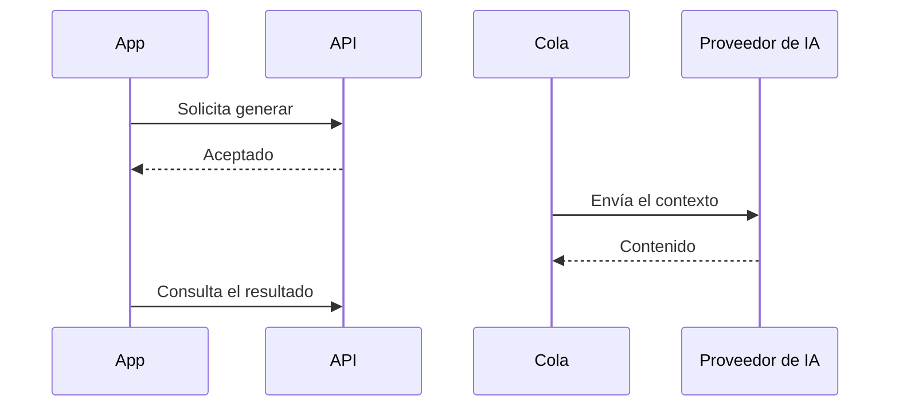

# Planner Odoo Backend

Backend de [Planner For Education](https://github.com/Jeisondls/planner-for-education), construido como módulos propios de Odoo sobre PostgreSQL. Reúne en un solo sistema la generación con IA, la gestión de usuarios y suscripciones, el CRM y la facturación.

> Código fuente privado (producto comercial). Este documento explica el enfoque de arquitectura; no describe el modelo de datos, las reglas de negocio ni la configuración del producto.

## Por qué Odoo

Planner no es solo una app: necesita usuarios, suscripciones, facturas, clientes potenciales y mensajería. Odoo ya resuelve esas piezas y las integra entre sí, así que el esfuerzo se concentra en lo propio del producto en vez de reconstruir un ERP.

## Áreas funcionales

| Área | Función |
|---|---|
| **Generación con IA** | Documentos docentes alineados al currículo oficial, expuestos mediante una API para la app |
| **Suscripciones** | Acceso según plan, integrado con las tiendas de aplicaciones |
| **Mensajería y CRM** | Seguimiento de interesados y comunicación con usuarios |
| **Contenido y sitio público** | Publicación de novedades y captación de interesados |

## Problemas y enfoque

| Problema | Enfoque |
|---|---|
| La IA tarda y una ráfaga de usuarios saturaría la app | Generación asíncrona: la API responde de inmediato y un proceso aparte, con recursos acotados, hace el trabajo |
| Los documentos deben respetar el currículo oficial | El currículo se modela como datos y el contexto se arma según nivel, grado y asignatura |
| Los documentos oficiales deben salir en PDF con formato correcto | Reportes QWeb parametrizados por tipo de documento |
| Solo los usuarios con acceso vigente deben generar | Control de acceso por capas, apoyado en el sistema de seguridad de Odoo |
| Cada pago debe quedar contabilizado | Integración con la facturación de Odoo |
| Seguridad moderna en la API | Autenticación con proveedores externos y factores adicionales, además de contraseñas |
| Cambiar la estructura sin romper datos en uso | Migraciones versionadas y pruebas automáticas |

## Ejemplos de la forma de trabajo

Fragmentos genéricos de las técnicas que uso, con las convenciones estándar de Odoo. Los nombres son ficticios y no corresponden al producto.

**Reporte PDF con QWeb:**

```xml
<?xml version="1.0" encoding="utf-8"?>
<odoo>
    <record id="paperformat_demo" model="report.paperformat">
        <field name="name">Demo (carta, horizontal)</field>
        <field name="format">Letter</field>
        <field name="orientation">Landscape</field>
    </record>

    <record id="action_report_demo" model="ir.actions.report">
        <field name="name">Demo</field>
        <field name="model">demo.document</field>
        <field name="report_type">qweb-pdf</field>
        <field name="report_name">demo_module.report_demo_document</field>
        <field name="paperformat_id" ref="paperformat_demo"/>
    </record>

    <template id="report_demo_document">
        <t t-call="web.html_container">
            <t t-foreach="docs" t-as="doc">
                <t t-call="web.external_layout">
                    <div class="page">
                        <h2 t-out="doc.name"/>
                    </div>
                </t>
            </t>
        </t>
    </template>
</odoo>
```

**Regla de registro:** cada usuario solo ve sus propios documentos.

```xml
<?xml version="1.0" encoding="utf-8"?>
<odoo>
    <record id="rule_demo_own_records" model="ir.rule">
        <field name="name">Demo: solo los registros propios</field>
        <field name="model_id" ref="model_demo_document"/>
        <field name="domain_force">[('user_id', '=', user.id)]</field>
        <field name="groups" eval="[(4, ref('base.group_user'))]"/>
    </record>
</odoo>
```

**Herencia de vista:** se extiende el modelo y la vista estándar sin tocar el núcleo.

```python
from odoo import fields, models


class ResPartner(models.Model):
    _inherit = "res.partner"

    external_contact = fields.Char(string="Contacto externo", copy=False)
```

```xml
<?xml version="1.0" encoding="utf-8"?>
<odoo>
    <record id="view_partner_form_external_contact" model="ir.ui.view">
        <field name="name">res.partner.form.external.contact</field>
        <field name="model">res.partner</field>
        <field name="inherit_id" ref="base.view_partner_form"/>
        <field name="arch" type="xml">
            <xpath expr="//field[@name='phone']" position="after">
                <field name="external_contact"/>
            </xpath>
        </field>
    </record>
</odoo>
```

## Flujo general de una generación



## Tecnologías

Odoo · Python · PostgreSQL · QWeb · API REST · OAuth · WebAuthn

## Relacionado

[Proyecto](https://github.com/Jeisondls/planner-for-education) · [Infraestructura](https://github.com/Jeisondls/planner-docker-infra)
