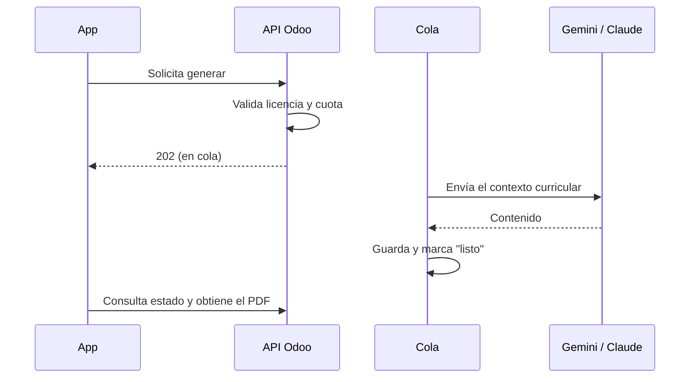
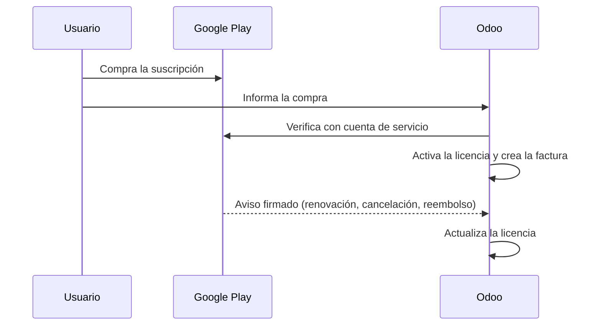

# Planner Odoo Backend

Backend de [Planner For Education](https://github.com/Jeisondls/planner-for-education), construido como **módulos propios de Odoo 17** sobre PostgreSQL. Concentra en un solo sistema la generación con IA, las licencias, el CRM, las ventas, la facturación, WhatsApp y el cobro.

> Código fuente privado (producto comercial). Este documento explica la arquitectura y las decisiones técnicas.

## Por qué Odoo

Planner no es solo una app: necesita usuarios, planes, facturas, clientes potenciales y mensajería. Con Odoo esas piezas ya existen y se integran entre sí, así que me concentré en lo propio del producto en vez de reconstruir un ERP.

## Módulos

| Módulo | Función |
|---|---|
| **Generación con IA** | Planificaciones diarias y de unidad, situaciones de aprendizaje e instrumentos. API REST para la app, licencias, cuotas y reportes PDF |
| **WhatsApp** | WhatsApp Business (Cloud API de Meta): bandeja de mensajes, plantillas, envío y configuración dentro de Odoo |
| **Novedades** | Artículos y novedades publicados desde el backend, enlazados con CRM y WhatsApp |
| **Sitio público** | Página de inicio, captación de interesados y mapa del sitio |
| **Asistente por voz** | Asistente «Oye Planner» con registro de uso y configuración por usuario |

## Problemas y soluciones

| Problema | Solución aplicada |
|---|---|
| La IA tarda y una ráfaga de usuarios saturaría la app | Generación asíncrona: la API responde de inmediato y una cola procesa los trabajos con estados `en cola`, `generando`, `listo` y `error`. Corre en un contenedor aparte con tope de CPU y memoria |
| Los documentos deben respetar el currículo oficial | El currículo vive como datos (competencias, contenidos, indicadores, criterios, estrategias, actividades) filtrados por nivel, grado y asignatura. Las instrucciones a la IA se arman por grado y asignatura |
| Los documentos oficiales deben salir en PDF con el formato correcto | Plantillas de reporte por ciclo y por tipo de área, con tipografías compatibles con Office instaladas en la imagen |
| Solo los usuarios con plan activo deben generar | Control de licencias en tres capas: grupos de usuarios, reglas de registro y validaciones en Python. Además, cuotas por tipo de recurso |
| Quien paga por Google Play debe activarse solo | Verificación de la compra en el servidor y avisos en tiempo real (Pub/Sub) para renovaciones, cancelaciones y reembolsos. Solo se aceptan avisos firmados por Google |
| Cada pago debe quedar contabilizado | Cada compra genera su factura en Odoo, en un diario propio para los cobros de Google Play |
| Atender y dar seguimiento a los interesados | CRM y ventas conectados al sitio y a WhatsApp, con los mensajes dentro de Odoo |
| Seguridad moderna en la API | Inicio de sesión con Google y Microsoft, passkeys (WebAuthn), verificación en dos pasos (TOTP) y tokens con renovación |
| Cambiar la estructura sin romper datos en uso | Migraciones versionadas por módulo y pruebas automáticas |

## XML y QWeb en Odoo

Gran parte del producto está declarada en XML y se muestra con QWeb, no solo en Python.

| Uso | Qué hice | Cifra |
|---|---|---|
| **Archivos XML** | Vistas, datos, reportes, seguridad y tareas programadas | 171 archivos |
| **Vistas** | Formularios, listas, kanban, búsqueda, calendario, gráfico y pivote | 107 vistas |
| **Herencia de vistas** | Extender vistas estándar de Odoo con `xpath`, sin tocar el núcleo | 57 puntos de herencia |
| **Acciones y menús** | Navegación del backend | 137 acciones · 195 menús |
| **Reportes PDF con QWeb** | Plantillas por ciclo y tipo de área, cada una con su formato de papel | 15 reportes · 11 formatos de papel |
| **Plantillas QWeb** | Reportes, sitio público y correos, con `t-foreach`, `t-if` y `t-call` | 68 plantillas |
| **Datos como XML** | El currículo oficial cargado como datos (competencias, contenidos, indicadores, estrategias, actividades) | 115 archivos de datos |
| **Seguridad declarativa** | Grupos, reglas de registro y permisos de acceso por modelo | 6 grupos · 47 reglas · 192 permisos |
| **Automatización** | Tareas programadas y acciones de servidor | 11 tareas · 2 acciones |
| **Correos** | Plantillas de correo transaccional | 2 plantillas |

### Ejemplos de la forma de trabajo

Fragmentos de muestra de las técnicas que uso, con las convenciones de Odoo 17. No incluyen el código real del producto.

**Reporte PDF con QWeb:** plantilla y acción que la publica.

```xml
<?xml version="1.0" encoding="utf-8"?>
<odoo>
    <record id="paperformat_planning" model="report.paperformat">
        <field name="name">Planificación (carta, horizontal)</field>
        <field name="format">Letter</field>
        <field name="orientation">Landscape</field>
        <field name="margin_top">20</field>
        <field name="margin_bottom">15</field>
    </record>

    <record id="action_report_planning" model="ir.actions.report">
        <field name="name">Planificación</field>
        <field name="model">school.planning</field>
        <field name="report_type">qweb-pdf</field>
        <field name="report_name">school_planner.report_planning_document</field>
        <field name="paperformat_id" ref="paperformat_planning"/>
        <field name="binding_model_id" ref="model_school_planning"/>
        <field name="binding_type">report</field>
    </record>

    <template id="report_planning_document">
        <t t-call="web.html_container">
            <t t-foreach="docs" t-as="planning">
                <t t-call="web.external_layout">
                    <div class="page">
                        <h2 t-out="planning.name"/>
                        <table class="table table-sm">
                            <thead>
                                <tr>
                                    <th>Actividad</th>
                                    <th>Observaciones</th>
                                </tr>
                            </thead>
                            <tbody>
                                <tr t-foreach="planning.line_ids" t-as="line">
                                    <td t-out="line.name"/>
                                    <td t-out="line.notes or '-'"/>
                                </tr>
                            </tbody>
                        </table>
                    </div>
                </t>
            </t>
        </t>
    </template>
</odoo>
```

**Regla de registro:** cada usuario solo ve y edita sus propios documentos.

```xml
<?xml version="1.0" encoding="utf-8"?>
<odoo>
    <record id="rule_planning_own_records" model="ir.rule">
        <field name="name">Planificación: solo los registros propios</field>
        <field name="model_id" ref="model_school_planning"/>
        <field name="domain_force">[('user_id', '=', user.id)]</field>
        <field name="groups" eval="[(4, ref('base.group_user'))]"/>
    </record>
</odoo>
```

**Herencia de vista:** el modelo se extiende en Python y el campo se añade a la vista estándar sin modificarla.

```python
from odoo import fields, models


class ResPartner(models.Model):
    _inherit = "res.partner"

    whatsapp_number = fields.Char(string="WhatsApp", copy=False)
```

```xml
<?xml version="1.0" encoding="utf-8"?>
<odoo>
    <record id="view_partner_form_whatsapp" model="ir.ui.view">
        <field name="name">res.partner.form.whatsapp</field>
        <field name="model">res.partner</field>
        <field name="inherit_id" ref="base.view_partner_form"/>
        <field name="arch" type="xml">
            <xpath expr="//field[@name='phone']" position="after">
                <field name="whatsapp_number"/>
            </xpath>
        </field>
    </record>
</odoo>
```

## Flujo de una generación



## Flujo de una compra



## Cifras

5 módulos propios · más de 200 rutas HTTP · 48 archivos de pruebas automáticas · 12 migraciones en un solo módulo

## Tecnologías

Odoo 17 · Python · PostgreSQL · QWeb (PDF) · API REST · OAuth · WebAuthn · Google Play Developer API · Pub/Sub · WhatsApp Cloud API · Gemini · Claude

## Relacionado

[App móvil](https://github.com/Jeisondls/planner-mobile) · [Versión web](https://github.com/Jeisondls/planner-web) · [Infraestructura](https://github.com/Jeisondls/planner-docker-infra)
